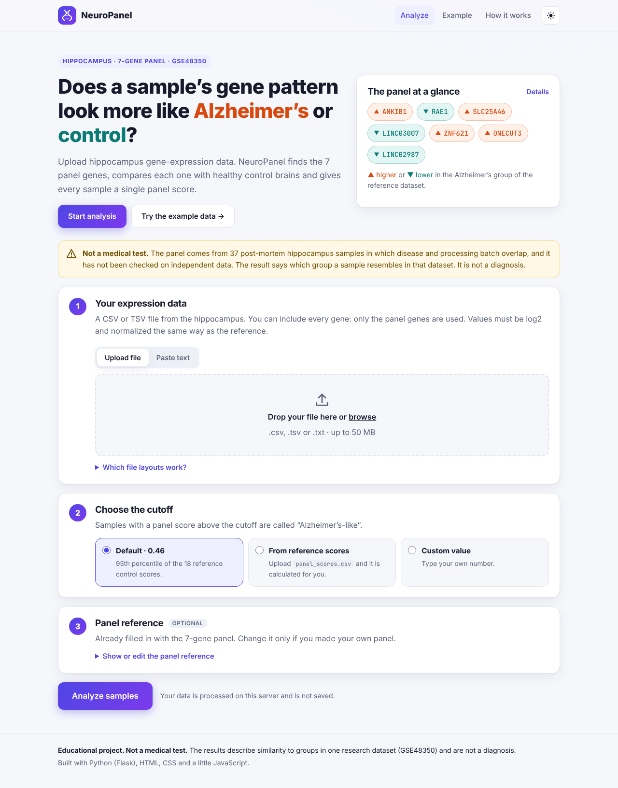
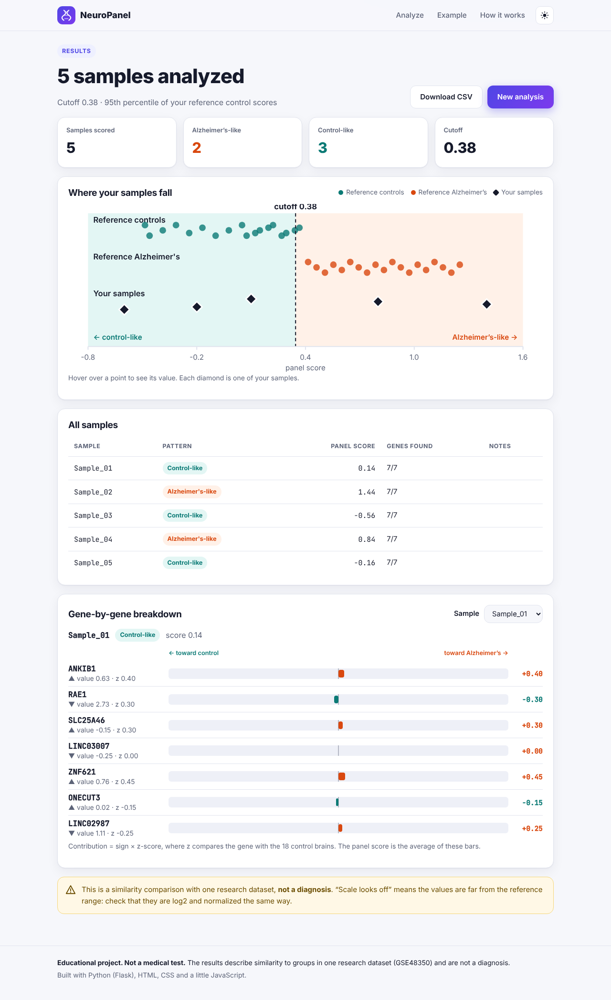
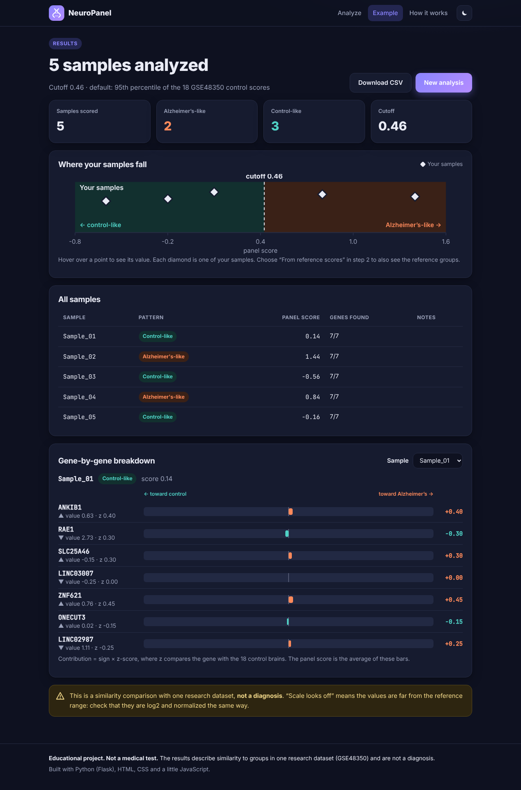
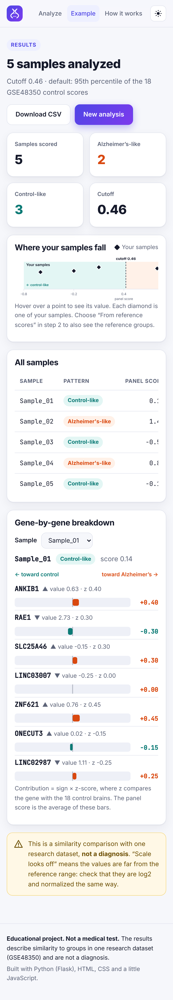

# NeuroPanel: hippocampus gene-panel explorer

A beginner Python project. It is a small website built with **Python (Flask)**, **HTML**, **CSS** and a little **JavaScript**.

You upload hippocampus gene-expression data and the site:

1. finds the 7 panel genes (your file can contain every gene),
2. compares each gene with 18 healthy control brains (z-score),
3. combines them into one **panel score** per sample,
4. says whether the sample's pattern looks more like the **Alzheimer's** group or the **control** group of the reference dataset (GSE48350).

> ⚠️ **Educational project, not a medical test.** The panel comes from 37 post-mortem hippocampus samples in which disease and processing batch overlap, and it has not been validated on independent data. The output is a similarity comparison, not a diagnosis.



## How to run it

You need Python 3.9 or newer.

```bash
# 1. (optional but recommended) create a virtual environment
python -m venv venv
source venv/bin/activate        # on Windows: venv\Scripts\activate

# 2. install Flask
pip install -r requirements.txt

# 3. start the website
python app.py
```

Then open **http://127.0.0.1:5000** in your browser. Click **Example** in the menu to see results straight away.

Run the tests:

```bash
python test_analysis.py
```

## Project structure

```
vaishu-project/
├── app.py                  # the website: pages and form handling (Flask)
├── analysis.py             # the science: reading files, z-scores, panel score
├── test_analysis.py        # simple tests with assert
├── requirements.txt        # Python packages needed (only Flask)
├── templates/              # HTML pages (Jinja templates)
│   ├── base.html           #   shared header, footer, theme button
│   ├── index.html          #   home page with the upload form
│   ├── results.html        #   results: summary, chart, table, gene bars
│   └── about.html          #   "How it works" page
└── static/
    ├── css/style.css       # all the styling (light + dark mode, mobile)
    ├── js/main.js          # small extras: tabs, drag & drop, theme, CSV download
    └── data/
        ├── panel_reference.csv     # the 7-gene panel
        └── example_expression.csv  # made-up example data to try the site
```

`analysis.py` does not import Flask, so you can test the science part on its own.

## The panel score

For each panel gene:

```
z            = (value - control_mean) / control_sd
contribution = sign * z          # sign = +1 if higher in Alzheimer's, -1 if lower
```

The panel score is the average contribution. If it is above the cutoff, the sample is called "Alzheimer's-like".
The default cutoff **0.46** is the 95th percentile of the 18 reference control scores. You can also calculate it from your own `panel_scores.csv` (columns `sample, group, panel_score`) or type your own number.

| Gene | Direction in Alzheimer's | Control mean (log2) | Control SD |
|---|---|---|---|
| ANKIB1 | higher | 0.423 | 0.525 |
| RAE1 | lower | 2.587 | 0.486 |
| SLC25A46 | higher | -0.327 | 0.589 |
| LINC03007 | lower | -0.254 | 0.238 |
| ZNF621 | higher | 0.497 | 0.587 |
| ONECUT3 | higher | 0.040 | 0.162 |
| LINC02987 | lower | 1.214 | 0.414 |

## Input file layouts

**Genes as rows** (one column per sample):

```
gene,patient_1,patient_2
ANKIB1,0.52,1.31
RAE1,2.61,1.98
APP,1.20,1.18
```

**Samples as rows** (one column per gene):

```
sample,group,ANKIB1,RAE1,SLC25A46,...
P1,control,0.52,2.61,-0.30,...
```

CSV, TSV and semicolon files all work. Values must be log2 and normalized the same way as the reference data, otherwise the site shows "scale looks off". If a gene appears on several rows (several probes), the row with the highest average is used.

## Screenshots

| Results (with reference scores) | Dark mode | Phone |
|---|---|---|
|  |  |  |

## Limitations

- Small dataset (37 samples: 18 control, 19 Alzheimer's).
- Disease and processing batch overlap in the reference data.
- Not validated on independent data.
- The example data in `static/data/example_expression.csv` is made up for demonstration.
