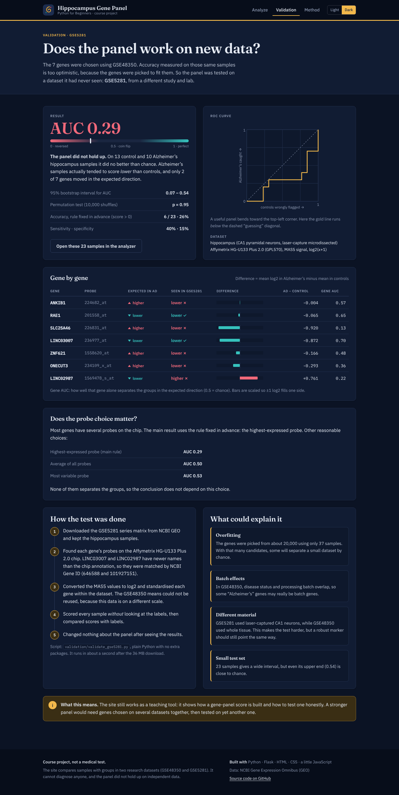

# Hippocampus gene panel

A course project for *Python for Beginners*. It is a small website written in **Python (Flask)**, **HTML**, **CSS** and a little **JavaScript**.

You upload gene-expression data from hippocampus tissue. The site picks out 7 genes that differed between Alzheimer's and control brains in the GSE48350 dataset and gives each sample a score: positive leans toward the Alzheimer's group, negative toward the control group.

> **Not a medical test.** The panel needs post-mortem brain tissue, was built from 37 samples, and **did not replicate** on an independent dataset (see [Validation](#validation-on-gse5281)). It is a teaching project about how a gene panel score works and how to check it honestly.


## How to run it

You need Python 3.9 or newer.

```bash
python -m venv venv
source venv/bin/activate        # Windows: venv\Scripts\activate
pip install -r requirements.txt
python app.py
```

Open **http://127.0.0.1:5000**. Click the links under the intro to try the built-in data without uploading anything.

Run the tests:

```bash
python test_analysis.py
```

Re-run the validation (downloads 36 MB from NCBI GEO the first time):

```bash
python validation/validate_gse5281.py
```

## What the site does

1. **Finds the 7 panel genes** in your file. Your file can contain every gene. If a gene has several rows (probes), the row with the highest average is used.
2. **Compares each gene with a baseline** (a z-score), using one of two choices:
   - **Your own batch** (10+ samples). This removes most lab and processing differences. It is used automatically when you upload 10 or more samples.
   - **The 18 GSE48350 control brains.** Only meaningful for data processed exactly like GSE48350. Samples on a different scale are flagged "scale looks off".
3. **Combines the genes** into one panel score: `average of (sign × z)`, where sign is +1 for genes higher in Alzheimer's and −1 for genes lower.
4. **Calls each sample** Alzheimer's-like or control-like using a cutoff: 0 in batch mode, 0.46 with the GSE48350 controls, or your own number.
5. **Checks the panel against your labels** (optional). If you add a `group` column or row with at least 3 controls and 3 Alzheimer's samples, the results page shows AUC, accuracy, sensitivity, specificity, and whether each gene moved in the expected direction. Labels are never used to calculate the scores.


## Validation on GSE5281

The genes were chosen on GSE48350, so accuracy measured on GSE48350 is too optimistic. The panel was therefore tested on **GSE5281**, a dataset it had never seen: 13 control and 10 Alzheimer's hippocampus samples on the same chip (Affymetrix HG-U133 Plus 2.0).

| | Result |
|---|---|
| AUC | **0.29** (95% bootstrap interval 0.07–0.54); 0.5 = coin flip |
| Permutation test | p = 0.95 |
| Accuracy (score > 0) | 6 of 23 (26%) |
| Genes in the expected direction | 2 of 7 |
| AUC with other probe choices | 0.50 (average of probes), 0.53 (most variable probe) |

**The panel does not separate Alzheimer's from control samples in GSE5281.** Possible reasons: the genes were picked from ~20,000 candidates using only 37 samples (overfitting), disease and processing batch overlap in GSE48350, and GSE5281 used laser-captured CA1 neurons rather than whole tissue. Nothing about the panel was changed after seeing these results.

How the test was done is in [`validation/validate_gse5281.py`](validation/validate_gse5281.py) (plain Python, standard library only) and on the Validation page of the site. LINC03007 and LINC02987 have newer names than the chip annotation, so they were matched by NCBI Gene ID: 646588 → probe `236977_at`, 101927151 → probe `1569478_s_at`.



## Project structure

```
vaishu-project/
├── app.py                    # the website: pages and form handling (Flask)
├── analysis.py               # reading files, z-scores, panel score, AUC
├── test_analysis.py          # simple tests with assert
├── requirements.txt          # only Flask
├── templates/                # HTML pages (Jinja)
│   ├── base.html             #   header and footer shared by all pages
│   ├── index.html            #   upload form
│   ├── results.html          #   results, chart, gene-by-gene bars
│   ├── validation.html       #   the GSE5281 check
│   └── about.html            #   how the score is calculated
├── static/
│   ├── css/style.css
│   ├── js/main.js            # theme button, form helpers, CSV download
│   └── data/
│       ├── panel_reference.csv      # the 7 genes + GSE48350 control mean/SD
│       └── example_expression.csv   # made-up example (5 samples)
├── validation/
│   ├── validate_gse5281.py   # independent test of the panel
│   └── results/              # its output (summary + the 23 samples)
└── docs/                     # screenshots for this README
```

`analysis.py` does not import Flask, so the science can be tested on its own.

## Design

- Light and dark mode (follows the computer's setting; the Light / Dark switch in the header remembers your choice).
- Colours carry meaning everywhere: **coral** = toward Alzheimer's, **teal** = toward control, **amber** = cutoff and highlights.
- All charts (heatmaps, ROC curve, score strip, gene bars) are drawn from the real numbers with plain SVG and CSS, with no chart library.
- Fonts: Fraunces (headings), IBM Plex Sans and IBM Plex Mono (text and numbers), from Google Fonts.
- Works on phones: the layout switches to one column below 720 px.

## Input file layouts

Genes as rows (an optional `group` row labels the samples):

```
gene,P1,P2,P3
group,control,AD,AD
ANKIB1,0.52,1.31,0.97
RAE1,2.61,1.98,2.10
```

Samples as rows (an optional `group` column):

```
sample,group,ANKIB1,RAE1,SLC25A46,...
P1,control,0.52,2.61,-0.30,...
```

CSV, TSV and semicolon-separated files work. Values should be log2.

## The panel

| Gene | In Alzheimer's (GSE48350) | Control mean (log2) | Control SD |
|---|---|---|---|
| ANKIB1 | higher | 0.423 | 0.525 |
| RAE1 | lower | 2.587 | 0.486 |
| SLC25A46 | higher | -0.327 | 0.589 |
| LINC03007 | lower | -0.254 | 0.238 |
| ZNF621 | higher | 0.497 | 0.587 |
| ONECUT3 | higher | 0.040 | 0.162 |
| LINC02987 | lower | 1.214 | 0.414 |

Means and SDs come from the 18 control samples of the cleaned GSE48350 hippocampus data (highest-expressed probe per gene).
